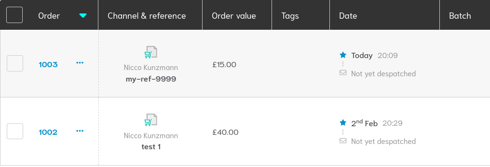

--8<-- "README.md"
- [LICENSE GPL-3.0 or later](LICENSE.md)


## Installation

```bash
pip install click_and_drop_api
```

## API Reference

This package has extensive documentation for the API Reference, which can be found [here](api.md).

## API Key

You need an API key to use the Click & Drop API.
You can get this key here:

1. Register an account at [parcel.royalmail.com](https://parcel.royalmail.com/)
2. Login at [auth.parcel.royalmail.com](https://auth.parcel.royalmail.com/)
3. Go to `Settings` → `Integrations` → `Add a new integration` → `Click & Drop API`
4. Fill out the details and save/update them.
5. Copy the `Click & Drop API authorisation key`

```bash
export API_KEY="aaaaaaaa-bbbb-cccc-dddd-eeeeeeeeeeee"
```

The API key will be used on the examples below to authenticate the requests.

### OBA

Some endpoints like generating labels require an OBA (Online Business Account).
Label generation is available for OBA accounts only:

- Private accounts pay as the label is generated.
- OBA accounts pay monthly via invoice.

This only OBA can generate labels on request.

1. [**Apply** for a Royal Mail Business Account (OBA)](https://www.royalmail.com/business/parcel-delivery).
2. [**Link** your OBA to Click & Drop](https://auth.parcel.royalmail.com/register/oba).
3. [**Fill** in required account information and make sure you follow the law][windsor].

[windsor]: https://help.parcel.royalmail.com/hc/en-gb/articles/21774606211997-Windsor-Framework-Posting-to-Northern-Ireland-from-Great-Britain#doyoushiptobusinesses

## Examples

This sections guides you through some examples.
Export the `API_KEY` of your account to run the examples.
The examples use the simple API that is based on the generated API and reduces the amount of code.

## Retrieve the version

[Version API Documentation](https://api.parcel.royalmail.com/#tag/Version)

Retrieving the version is useful to understand if you can use the API without authentication.

```python
--8<-- "click_and_drop_api/examples/view_version.py"
```

Output:

```text
--8<-- "click_and_drop_api/examples/view_version.py.out"
```

## View specific orders

[Orders API Documentation](https://api.parcel.royalmail.com/#tag/Orders)

The image below shows orders that were created as examples.



The script below retrieves information about these orders, by id (`int`) and by reference (`str`).

```python
--8<-- "click_and_drop_api/examples/view_specific_orders.py"
```

Output:

```text
--8<-- "click_and_drop_api/examples/view_specific_orders.py.out"
```

## View a single order

```python
--8<-- "click_and_drop_api/examples/view_order.py"
```

## Create and delete orders

[Orders API Documentation](https://api.parcel.royalmail.com/#tag/Orders)

The script below creates a new order and then deletes it.

```python
--8<-- "click_and_drop_api/examples/create_order.py"
```

Output:

```text
--8<-- "click_and_drop_api/examples/create_order.py.out"
```

## Avoid duplicate order references

Click & Drop accepts several orders with the same reference.
Afterwards, these orders cannot be retrieved or deleted by their reference:
the API answers with error code `5`, "Ambiguous reference".

If the references usually do not exist yet, `replace_orders()` needs the fewest requests:
it uploads the orders, looks the references up in one request, and only if a reference
now has several orders, it deletes the older ones.

```python
response = api.replace_orders(orders)
```

If an older order cannot be deleted (manifested, a printed label unless `delete_printed=True`),
the new order is deleted instead and is in `response.failed_orders`.

Pass a strategy to the API to check orders before they are created.
`ReplaceDuplicateReferences` deletes existing orders with the same references before the upload:

```python
from click_and_drop_api.simple import ClickAndDrop, ReplaceDuplicateReferences

api = ClickAndDrop(key, create_order_strategy=ReplaceDuplicateReferences())
response = api.create_orders(orders)
```

- `NullStrategy` uploads the orders as given. This is the default.
- `RejectDuplicateReferences` does not upload orders whose reference already exists.
  It does not list the orders.
- `ReplaceDuplicateReferences` deletes all existing orders with the same reference first, including duplicates.
  - Manifested orders cannot be deleted, so these orders are not uploaded.
  - Orders with a printed label are not deleted because that cancels the label.
    Pass `delete_printed=True` to delete them anyway.
  - Click & Drop cannot look up a reference that has several orders (error code `5`),
    and it does not tell how many orders the reference has.
    So orders are listed with `GET /orders` until two of them are found.
    Click & Drop lists the newest orders first, and duplicates are usually recent.
    These are deleted and the reference is looked up again, until all of its orders are deleted.
    The listing continues where it stopped, so no page is listed twice.
    Pass `lookback=timedelta(days=...)` to not list orders uploaded before that.
- You can also pass a strategy to a single call: `api.create_orders(orders, strategy=NullStrategy())`.
- Write your own strategy by subclassing `CreateOrderStrategy`.

Strategies do not raise errors.
Orders that are not uploaded are in `response.failed_orders`, next to the orders that Click & Drop rejects.
All other orders are uploaded.
The error codes of the strategies are negative, see `StrategyErrorCode`:

| Code | Name | Reason |
|------|------|--------|
| -1 | `DUPLICATE_REFERENCE` | The reference exists (`RejectDuplicateReferences`) or appears several times in the upload. |
| -2 | `ORDER_MANIFESTED` | An existing order with the reference is manifested. |
| -3 | `LABEL_ALREADY_PRINTED` | An existing order with the reference has a printed label. |
| -4 | `DELETE_FAILED` | Click & Drop did not delete an existing order with the reference. |

- `lookup_references(references)` looks up references without listing the orders.
  It returns a `ReferenceLookup` with the sets `absent`, `unique` and `ambiguous` (several orders),
  the property `existent` (`unique | ambiguous`), and the `orders` of the unique references.
- `find_orders_by_reference(references)` returns the orders of each reference.
  For a reference with several orders, it stops listing orders as soon as two are found.
  Pass `orders=` an iterator of a previous search to continue it.
- `iter_orders(start, end)` iterates over all orders page by page, from the newest to the oldest.
  Click & Drop filters by the upload time (`created_on`), not by `order_date`,
  and cuts the times off to whole seconds: `start` is inclusive, `end` is exclusive
  and must be at least one second after `start`.
  There is no limit on the time span.
- `iter_recent_orders(until)` iterates over the orders uploaded since `until`, from the newest to the oldest.
- They accept an empty list of references and then do not call Click & Drop.

## Errors

All errors raised by `click_and_drop_api.simple` are subclasses of `ClickAndDropError`.
`InvalidWeight` and `InvalidDimensions` are also `ValueError`s.
Errors of the HTTP requests are raised as `click_and_drop_api.exceptions.ApiException`.

## Package sizes and their shipping options

Several shipping options are available for each package size.
There is no API for this, so the price and delivery speed is hard coded.
You can view the table when you apply postage to an order.
If the values are outdated, you are welcome to update them with a pull request and a screenshot of the table on the website.

This example prints all the available package sizes and their shipping options.

```python
--8<-- "click_and_drop_api/examples/package_size_and_cost.py"
```

Output:

```text
--8<-- "click_and_drop_api/examples/package_size_and_cost.py.out"
```

## Print shipping countries for a service code

This example prints every country that accepts a given service code by testing each one via the API.
Test orders are created and immediately deleted — no real shipments are made.

```python
--8<-- "click_and_drop_api/examples/shipping_countries.py"
```

Output:

```text
--8<-- "click_and_drop_api/examples/shipping_countries.py.out"
```

## Check if account is OBA

Some features — such as label generation and OBA-only service codes — require an OBA (Online Business Account).
This example checks whether your account is an OBA by sending a test order with an OBA service code and immediately deleting it.

```python
--8<-- "click_and_drop_api/examples/check_oba.py"
```

Output:

```text
--8<-- "click_and_drop_api/examples/check_oba.py.out"
```

## Create postage labels

[Labels API Documentation](https://api.parcel.royalmail.com/#tag/Labels)

! **Labels are only available for OBA accounts** !

The script below takes an order id or reference as an argument and generates a postage label for it.

```python
--8<-- "click_and_drop_api/examples/generate_label.py"
```
